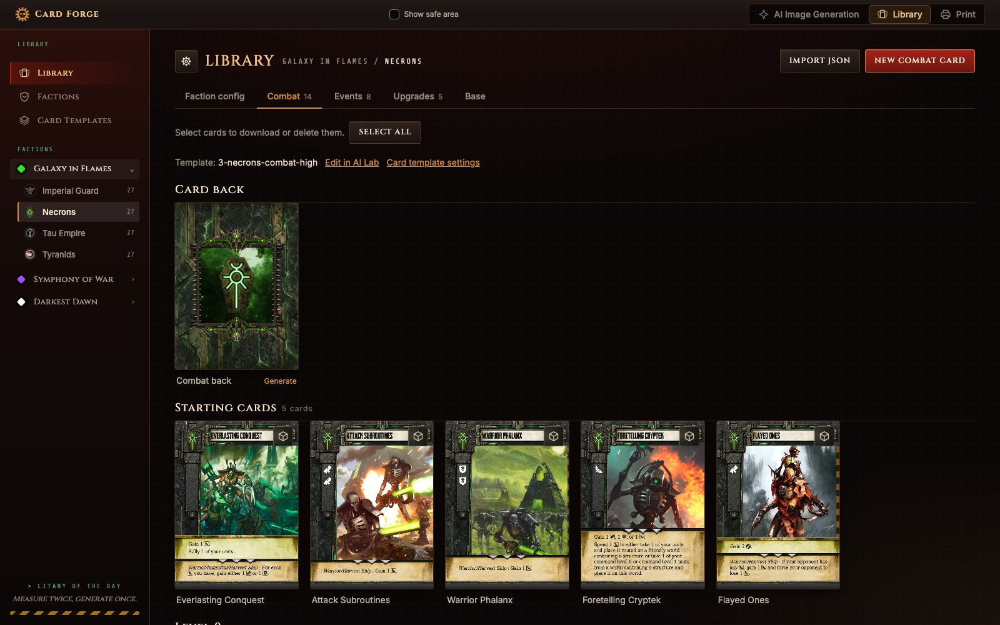
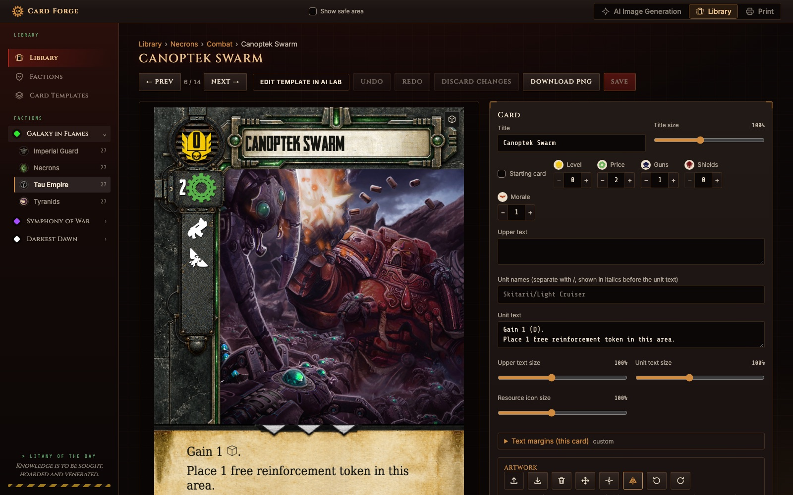
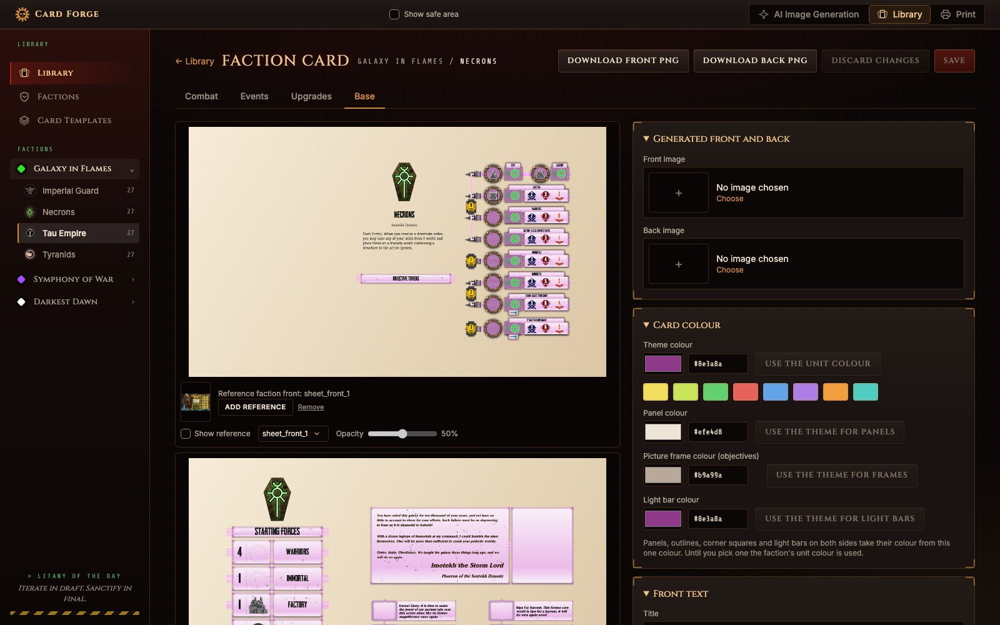
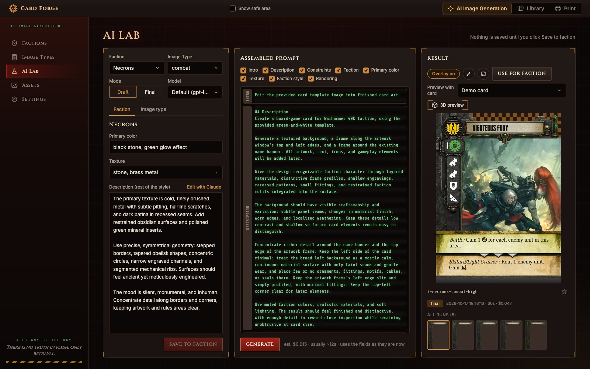
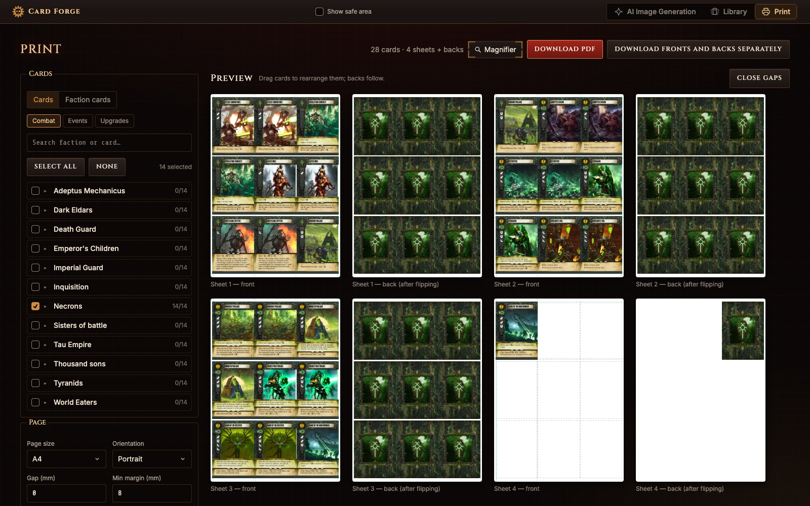

# Card Forge

A local web app for designing a homemade expansion for the board game
*Forbidden Stars*: generate card art with AI, assemble combat, event and
upgrade cards, lay out each faction's card, and print everything as a PDF
ready to cut.

Unofficial fan project, not affiliated with or endorsed by Fantasy Flight
Games or Games Workshop. See [Assets and rights](#assets-and-rights).

## What it does

| | |
|---|---|
| **Card library**: every faction's combat, event and upgrade cards, rendered on the faction's template, with its card back. |  |
| **Card editor**: title, rules text, level, price and resources, artwork you can move and zoom, live preview. |  |
| **Faction card**: the 258 × 152 mm faction sheet with its unit table, starting forces, story and objectives. |  |
| **AI Lab**: build a prompt from the faction's style and generate frames and card backs with the OpenAI Image API. |  |
| **Print**: arrange cards on A4/A5/A6 sheets with backs, bleed and cutting lines, then download a PDF. |  |

## Quick start

You need Go 1.25+, Node 22+ and, for image generation, an OpenAI API key.

```sh
make dev-server   # API on http://localhost:8080 (SQLite in server/data/)
make dev-web      # app on http://localhost:5173
```

Open http://localhost:5173 and add your OpenAI key under
**AI Image Generation → Settings**, or set `OPENAI_API_KEY` before starting
the server.

Production build: `make build`, then run `./bin/cardforge` and open
http://localhost:8080. Tests: `make test`.

## Learn more

- [FAQ](docs/FAQ.md): how the library, editor, templates, faction card and
  printing work. The same page is in the app under **FAQ**.
- [Product requirements](docs/prd/PRD-1.md) and [design specs](docs/superpowers/specs/).

## License

The source code is open source under the [MIT License](LICENSE).

## Assets and rights

The MIT License covers the code only. It does not cover the assets in this
repository or anything made with the app: images, icons, 3D models, fonts,
artwork, card texts, faction names and other game content. All rights to
them belong to their authors and owners. Forbidden Stars is a trademark of
Fantasy Flight Games; Warhammer 40,000 and its factions, names and imagery
are trademarks of Games Workshop.

Before you publish, print for others, sell or otherwise share cards or
assets, ask their owners for permission. Generated artwork may also be
subject to the terms of the AI service that produced it.
